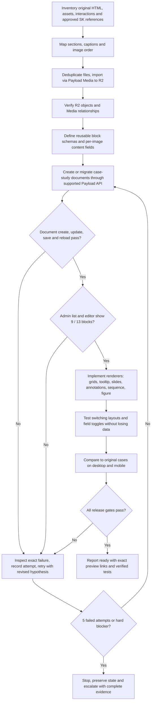

# SK Portfolio CMS migration: execution log and acceptance gates

Canonical handoff for humans and agents. Scope: preview branch `integration/payload-cms`; never modify production `main` without explicit instruction.

## Objective
Migrate the approved Centronic and Haptix case-study text, 57 distinct R2 Media assets, 75 image placements, shared editorial blocks and advanced SK Media Playground presentations to editable Payload CMS documents, faithfully rendered and safely editable.

## Workflow / flowchart

## Release gates (mandatory, NOT inferred from Vercel READY)
- G1: Preview database only; original main website unchanged.
- G2: Both canonical pages returned from Payload list, detail, admin list, and editor; correct number of blocks.
- G3: Create -> edit -> save -> reload works on a **disposable** test document; cleanup is safe.
- G4: Both canonical pages save and reload without duplicate ID errors, using non-destructive test fields.
- G5: 57 distinct R2-backed media assets and all 75 case-study image placements persist.
- G6: Presentation variant / visibility toggles save, reload and preserve hidden content.
- G7: Frontend matches approved source content and SK design/playground behaviors; desktop/mobile visual and functional QA.
- G8: Vercel READY, runtime checks and administration checks corroborate actual usability.
- If any gate fails, no 'complete' or 'ready' claim.

## Failure handling agreement
- Log each meaningfully distinct attempt, hypothesis, exact change, validation, result and rollback/commit.
- A failed attempt means a specific proposed fix did not pass its test, not each individual command/tool invocation.
- Continue investigating through up to **five failed repair attempts** before asking user for a new direction, unless blocked by credentials, risk of data loss, production effects or an action requiring explicit permission.
- Do not deploy a speculative repair just to test it if local or isolated tests can reproduce the failure.
- Avoid user-facing failure updates until the five-attempt threshold; provide meaningful completion messages or safety blockers as necessary.
- Append new entries chronologically. Never overwrite failed entries or silently call a partial pass complete.

## Baseline and attempted repairs (retrospective, not a new five-attempt cycle)
| ID | Attempt / evidence | Result | Follow-up |
|---|---|---|---|
| H01 | Direct SQL inserts into Payload pages, child-block tables and version tables | PARTIAL: SQL stores 9 Centronic / 13 Haptix blocks; admin screenshot showed 0 Layouts | Must validate using Payload document workflows, not SQL counts |
| H02 | Import asset pilot in build migration: 3 images | PASS: 3 Media records with R2 URLs and linked placements | Full batch required |
| H03 | Full remaining Media import via build migration | PASS: 54 additional assets, 0 failures; 57 total, 75 placements linked | Do not re-import |
| H04 | Add content fields, toggles and layout modes | PARTIAL: schema migration and frontend build passed; advanced Playground animation not implemented; editor persistence unverified | Keep design and functionality separate |
| H05 | Direct document update from migration `20261030_050000_resave_page_layouts` | FAIL: Payload/Drizzle duplicate `id` validation | Don't use migration transaction for repair |
| H06 | Read-only Payload list+detail audit `20261030_060000_layout_read_audit` | PASS: list and detail each report 9/13 blocks; older admin screenshot reported 0 | Admin UI discrepancy requires independent verification |
| H07 | Fresh page reconstruction inside migration | FAIL/ABORTED: nested connection blocked on transaction lock; deployment canceled; transaction rolled back | Run outside migration transaction |
| H08 | Standalone script `payload run`, initial unawaited execution | FAIL: script returned success without running to completion; no data change | Must await entrypoint and assert DB state |
| H09 | Awaited standalone repair, new clean staging page `cms-rebuilt-centronic` | PARTIAL/FAIL: Payload created new page id 4 but its update threw duplicate `id` validation | Diagnose Payload/Drizzle update path and nested version/array IDs |
| H10 | Rolled integration branch back to known ready audit commit `387674b55b1aa38e0a404922f87f7b590fb6fcae` | PASS: code branch restored; temporary staging record id 4 still exists | Preserve staging record until explicitly safely resolved |

## Current observed state
- Canonical pages: Centronic id 1, Haptix id 2. Both `updated_at` stayed `2026-10-29T14:19:57.603Z` at last check.
- Block counts from Payload document API: 9 and 13. Admin screenshot displayed `0 Layouts`; do not assume discrepancy resolved.
- Imported R2 case-study Media: 57 distinct images; linked image placements: 20 Centronic and 55 Haptix.
- Staging artifact: `cms-rebuilt-centronic`, id 4, created by attempted repair. Do not delete blindly.
- Root save error: `ValidationError: The following field is invalid: id`, value must be unique, on Payload update; root cause not yet established.
- Production branch remains unchanged.

## Next attempt register
| New attempt | Hypothesis | Code/data change | Test and observation | Outcome | Commit/rollback |
|---|---|---|---|---|---|
| N01 | Determine whether Payload update fails on newly created page, with exact validation details | Added read-only diagnostic plus controlled update on staging id 4 | Await build logs | RUNNING | diagnostic commit |
| N02 | Not attempted | Not attempted | Not attempted | PENDING | |
| N03 | Not attempted | Not attempted | Not attempted | PENDING | |
| N04 | Not attempted | Not attempted | Not attempted | PENDING | |
| N05 | Not attempted | Not attempted | Not attempted | PENDING | |

## Rules for all agents
Read this file **before** attempting another CMS repair. Inspect the latest branch and Neon preview state, not just this historical snapshot. A green build is not a green CMS. Keep the user's original prose and SK interaction/design direction; never substitute unrelated templates. Existing R2 assets are the source of truth for media. Never overwrite actual user edits during a repair.
