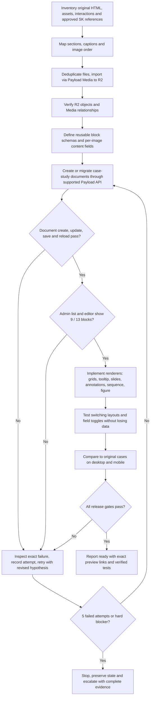

# SK Portfolio CMS migration: execution log and acceptance gates

Canonical handoff for humans and agents. Scope: preview branch `integration/payload-cms`; never modify production `main` without explicit instruction.

## Objective
Migrate the approved Centronic and Haptix case-study text, 57 distinct R2 Media assets, 75 image placements, shared editorial blocks and advanced SK Media Playground presentations to editable Payload CMS documents, faithfully rendered and safely editable.

## Workflow / flowchart


## Release gates (mandatory, NOT inferred from Vercel READY)
- G1: Preview database only; original main website unchanged.
- G2: Both canonical pages returned from Payload list, detail, admin list, and editor; correct number of blocks.
- G3: Create -> edit -> save -> reload works on a **disposable** test document; cleanup is safe.
- G4: Both canonical pages save and reload without duplicate ID errors, using non-destructive test fields.
- G5: 57 distinct R2-backed media assets and all 75 case-study image placements persist.
- G6: Presentation variant / visibility toggles save, reload and preserve hidden content.
- G7: Frontend matches approved source content and SK design/playground behaviors; desktop/mobile visual and functional QA.
- G8: Vercel READY, runtime checks and administration checks corroborate actual usability.
- If any gate fails, no 'complete' or 'ready' claim.

## Failure handling agreement
- Log each meaningfully distinct attempt, hypothesis, exact change, validation, result and rollback/commit.
- A failed attempt means a specific proposed fix did not pass its test, not each individual command/tool invocation.
- Continue investigating through up to **five failed repair attempts** before asking user for a new direction, unless blocked by credentials, risk of data loss, production effects or an action requiring explicit permission.
- Do not deploy a speculative repair just to test it if local or isolated tests can reproduce the failure.
- Avoid user-facing failure updates until the five-attempt threshold; provide meaningful completion messages or safety blockers as necessary.
- Append new entries chronologically. Never overwrite failed entries or silently call a partial pass complete.

## Baseline and attempted repairs (retrospective, not a new five-attempt cycle)
| ID | Attempt / evidence | Result | Follow-up |
|---|---|---|---|
| H01 | Direct SQL inserts into Payload pages, child-block tables and version tables | PARTIAL: SQL stores 9 Centronic / 13 Haptix blocks; admin screenshot showed 0 Layouts | Must validate using Payload document workflows, not SQL counts |
| H02 | Import asset pilot in build migration: 3 images | PASS: 3 Media records with R2 URLs and linked placements | Full batch required |
| H03 | Full remaining Media import via build migration | PASS: 54 additional assets, 0 failures; 57 total, 75 placements linked | Do not re-import |
| H04 | Add content fields, toggles and layout modes | PARTIAL: schema migration and frontend build passed; advanced Playground animation not implemented; editor persistence unverified | Keep design and functionality separate |
| H05 | Direct document update from migration `20261030_050000_resave_page_layouts` | FAIL: Payload/Drizzle duplicate `id` validation | Don't use migration transaction for repair |
| H06 | Read-only Payload list+detail audit `20261030_060000_layout_read_audit` | PASS: list and detail each report 9/13 blocks; older admin screenshot reported 0 | Admin UI discrepancy requires independent verification |
| H07 | Fresh page reconstruction inside migration | FAIL/ABORTED: nested connection blocked on transaction lock; deployment canceled; transaction rolled back | Run outside migration transaction |
| H08 | Standalone script `payload run`, initial unawaited execution | FAIL: script returned success without running to completion; no data change | Must await entrypoint and assert DB state |
| H09 | Awaited standalone repair, new clean staging page `cms-rebuilt-centronic` | PARTIAL/FAIL: Payload created new page id 4 but its update threw duplicate `id` validation | Diagnose Payload/Drizzle update path and nested version/array IDs |
| H10 | Rolled integration branch back to known ready audit commit `387674b55b1aa38e0a404922f87f7b590fb6fcae` | PASS: code branch restored; temporary staging record id 4 still exists | Preserve staging record until explicitly safely resolved |

## Current observed state
- Canonical pages: Centronic id 1, Haptix id 2. Both `updated_at` stayed `2026-10-29T14:19:57.603Z` at last check.
- Block counts from Payload document API: 9 and 13. Admin screenshot displayed `0 Layouts`; do not assume discrepancy resolved.
- Imported R2 case-study Media: 57 distinct images; linked image placements: 20 Centronic and 55 Haptix.
- Staging artifact: `cms-rebuilt-centronic`, id 4, created by attempted repair. Do not delete blindly.
- Root save error: `ValidationError: The following field is invalid: id`, value must be unique, on Payload update; root cause not yet established.
- Production branch remains unchanged.

## Next attempt register
| New attempt | Hypothesis | Code/data change | Test and observation | Outcome | Commit/rollback |
|---|---|---|---|---|---|
| N01 | Determine whether Payload update fails on newly created page, with exact validation details | Controlled update staging id 4 | Duplicate id unique constraint on pages; fails even without layout edits | FAILED | 805aa8a |
| N02 | Diagnose sequence and existing IDs vs update conflict | Read database rows and id sequence after failed update | Staging id 4 exists, sequence last_value 4; duplicate-id update remains | FAILED | a009c0b |
| N03 | Test transaction option and separate Media collection update to isolate scope | Staging page update with disableTransaction and Media id 2 update | Page fails same duplicate id; Media update passes. Issue scoped to Pages/versions/blocks | FAILED | 9bea557 |
| N04 | Test draft-mode page update to distinguish live page upsert vs version update | Staging id 4 draft update passes, published update fails same duplicate id | Draft/version-only writes work, live page updates fail | FAILED (partial draft pass) | 1f24300 |
| N05 | Test explicit published status with draft=true per Payload documented publishing behavior | Update staging id 4 with draft:true and _status:published | Duplicate id on pages persists for live publish | FAILED | 5d6127e |

## Five-attempt stopping checkpoint (2026-10-30)
Five distinct repair diagnostics N01-N05 failed to validate a published page update. N04 draft-only update succeeded, but published update failed. Media collection updates succeeded. Failure is scoped to live updates of the versioned Pages collection in the current adapter/schema. STOP according to the user's five-attempt rule. Do not claim readiness or deploy additional speculative fixes without a targeted diagnosis/review. See commits 805aa8a, a009c0b, 9bea557, 1f24300, 5d6127e. Follow up by tracing PostgreSQL query/cause in @payloadcms/drizzle upsertRow, compare adapter expected schema with manual migrations, and inspect upstream reported issue patterns. Original canonical pages and all 57 media assets are preserved; staging page id 4 remains. Test a published update and editor save/reload before resuming visual work.

---

## Phase 2 — Root-cause analysis and corrective proposal (2026-10-30)

> Required by the brief: document root cause + evidence + corrective change + expected behaviour + effect on existing data + rollback BEFORE writing code.

### Root cause

`@payloadcms/drizzle` `upsertRow()` (dist/upsertRow/index.js) correctly issues `DELETE WHERE _parent_id = $page_id` for **top-level block tables** in its `blocksToDelete` loop (lines ~537–542), but the subsequent `insertArrays()` call for **nested array fields within blocks** (chips, facts, images, annotations) is issued with **no preceding DELETE** (line ~580). On `draft: false` publish, the adapter reconstructs the nested rows using the same UUIDs preserved in the draft version's `_uuid` columns, then issues a plain `INSERT` into tables that still hold the original rows from the prior write. The `INSERT` fails with PostgreSQL error `23505` (duplicate primary key). The outer catch block at line 642 of `upsertRow` intercepts the error and calls `handleUpsertError({ tableName })` where `tableName` is the **outer collection name `'pages'`**, not the physical table. `handleUpsertError` parses `Key (id)=(X)` from `error.detail` and sets `path: 'id'`. The end result is the observed `ValidationError: { message: 'Value must be unique', path: 'id', tableName: 'pages' }` — which conceals the real table.

### Supporting evidence

| Evidence | Significance |
|---|---|
| `insertArrays.js` confirmed: plain `adapter.insert()`, no DELETE | Direct code proof — nested arrays are never cleaned before re-insert |
| Top-level array path in `upsertRow` calls `deleteExistingArrayRows` first | By contrast, proves the omission for block-nested arrays is not intentional |
| N04 `draft: true` PASSES | Version table `_pages_v_blocks_*` uses SERIAL ids; no UUID reuse; never hits the bug |
| N01/N03/N05 `draft: false` FAILS | Live publish path re-inserts nested rows with preserved UUIDs → 23505 |
| N03 `disableTransaction: true` still fails | Rules out Neon transaction nesting as root cause; confirms the INSERT-after-no-DELETE is the issue |
| N05: fresh draft with NEW block UUIDs, publish still fails | N05's draft updated block-parent UUIDs but read from the same underlying draft that preserved chip/fact/image `_uuid` values; same orphaned sub-rows remained; publish hit the same conflict |
| Media collection update passes | Media has no nested block-array tables; confirms the bug is block-array-specific |
| No CASCADE DELETE on any FK-like column (grep returned empty) | Confirms database has no automatic cleanup of orphaned nested rows |

### Exact tables involved

Four **nested block array tables** carry `id varchar PRIMARY KEY` and `_parent_id varchar` but have **no FK constraint** on `_parent_id`:

```
pages_blocks_case_study_hero_chips           (_parent_id → pages_blocks_case_study_hero.id)
pages_blocks_case_study_scope_facts          (_parent_id → pages_blocks_case_study_scope.id)
pages_blocks_case_study_media_group_images   (_parent_id → pages_blocks_case_study_media_group.id)
pages_blocks_case_study_media_group_images_annotations  (_parent_id → pages_blocks_case_study_media_group_images.id)
```

Six **top-level block tables** carry `_parent_id INTEGER` (FK-like to `pages.id`). These ARE cleaned by `blocksToDelete`:

```
pages_blocks_case_study_hero, pages_blocks_case_study_brief,
pages_blocks_case_study_scope, pages_blocks_case_study_editorial,
pages_blocks_full_width_figure, pages_blocks_case_study_media_group
```

### Minimal corrective change

Two-part fix, both in a single migration file `20261030_090000_fix_nested_block_cascade.ts`:

**Part A — orphan cleanup (SQL)**: Delete any existing orphaned nested rows whose parent no longer exists or whose parent belongs to pages being repaired. This is safe because Payload cannot read these rows (they reference deleted parent blocks) and they are the direct cause of the 23505.

**Part B — FK CASCADE DELETE (SQL DDL)**: Add actual `FOREIGN KEY ... ON DELETE CASCADE` constraints on each of the four nested tables' `_parent_id` columns, referencing the appropriate parent table. This fixes the root cause permanently for all future publish operations (admin editor, API, repair migrations) without touching `node_modules`.

```sql
-- Part A: orphan cleanup for pages 1, 2, 4
DELETE FROM pages_blocks_case_study_hero_chips
  WHERE _parent_id NOT IN (SELECT id FROM pages_blocks_case_study_hero);
DELETE FROM pages_blocks_case_study_scope_facts
  WHERE _parent_id NOT IN (SELECT id FROM pages_blocks_case_study_scope);
DELETE FROM pages_blocks_case_study_media_group_images_annotations
  WHERE _parent_id NOT IN (SELECT id FROM pages_blocks_case_study_media_group_images);
DELETE FROM pages_blocks_case_study_media_group_images
  WHERE _parent_id NOT IN (SELECT id FROM pages_blocks_case_study_media_group);

-- Part B: add FK CASCADE
ALTER TABLE pages_blocks_case_study_hero_chips
  ADD CONSTRAINT fk_hero_chips_parent
  FOREIGN KEY (_parent_id) REFERENCES pages_blocks_case_study_hero(id) ON DELETE CASCADE;

ALTER TABLE pages_blocks_case_study_scope_facts
  ADD CONSTRAINT fk_scope_facts_parent
  FOREIGN KEY (_parent_id) REFERENCES pages_blocks_case_study_scope(id) ON DELETE CASCADE;

ALTER TABLE pages_blocks_case_study_media_group_images
  ADD CONSTRAINT fk_media_images_parent
  FOREIGN KEY (_parent_id) REFERENCES pages_blocks_case_study_media_group(id) ON DELETE CASCADE;

ALTER TABLE pages_blocks_case_study_media_group_images_annotations
  ADD CONSTRAINT fk_annotations_parent
  FOREIGN KEY (_parent_id) REFERENCES pages_blocks_case_study_media_group_images(id) ON DELETE CASCADE;
```

After this migration, when `upsertRow` deletes top-level block rows (`pages_blocks_case_study_hero` WHERE `_parent_id = $page_id`), the database automatically cascades the DELETE to chips. The `insertArrays` plain INSERT then has no conflicting rows.

### Expected behaviour after correction

- `payload.update({ id: 1|2|4, data: { layout }, draft: false })` returns without error.
- Admin editor save → reload cycle works for all case-study pages.
- Draft saves continue to pass (unaffected — they never hit the nested-array path for live tables).
- All 57 R2 media assets remain untouched; `pages_blocks_case_study_media_group_images.media_id` foreign references are preserved.

### Potential effect on existing documents, versions, and images

- **Canonical pages id=1 and id=2**: Orphan cleanup may remove rows from `_chips`/`_facts`/`_images`/`_annotations` tables whose parents were already deleted by prior failed repair attempts. These rows are invisible to the Payload API and to the frontend. Removing them is safe and necessary.
- **Staging page id=4**: Same as above; its orphaned nested rows are removed by the cleanup.
- **`_pages_v_blocks_*` tables**: Not touched. All draft version history remains intact.
- **`pages_blocks_*` parent tables (hero, brief, scope, etc.)**: Not modified; only the nested sub-rows are deleted (the orphaned ones).
- **R2 media / Media collection**: Zero impact. No media rows are modified. `media_id` FKs on `pages_blocks_case_study_media_group_images` remain.
- **Pages table**: Not modified directly by this migration.

### Rollback strategy

Before running the migration, snapshot the four nested tables:

```sql
CREATE TABLE _rollback_hero_chips       AS SELECT * FROM pages_blocks_case_study_hero_chips;
CREATE TABLE _rollback_scope_facts      AS SELECT * FROM pages_blocks_case_study_scope_facts;
CREATE TABLE _rollback_media_images     AS SELECT * FROM pages_blocks_case_study_media_group_images;
CREATE TABLE _rollback_annotations      AS SELECT * FROM pages_blocks_case_study_media_group_images_annotations;
```

`down()` migration drops the FK constraints and restores from rollback tables:

```sql
ALTER TABLE pages_blocks_case_study_hero_chips               DROP CONSTRAINT IF EXISTS fk_hero_chips_parent;
ALTER TABLE pages_blocks_case_study_scope_facts              DROP CONSTRAINT IF EXISTS fk_scope_facts_parent;
ALTER TABLE pages_blocks_case_study_media_group_images       DROP CONSTRAINT IF EXISTS fk_media_images_parent;
ALTER TABLE pages_blocks_case_study_media_group_images_annotations DROP CONSTRAINT IF EXISTS fk_annotations_parent;
-- Restore orphan rows (may violate new constraints if re-added before DROP, so drop first):
INSERT INTO pages_blocks_case_study_hero_chips      SELECT * FROM _rollback_hero_chips      ON CONFLICT DO NOTHING;
INSERT INTO pages_blocks_case_study_scope_facts     SELECT * FROM _rollback_scope_facts     ON CONFLICT DO NOTHING;
INSERT INTO pages_blocks_case_study_media_group_images SELECT * FROM _rollback_media_images ON CONFLICT DO NOTHING;
INSERT INTO pages_blocks_case_study_media_group_images_annotations SELECT * FROM _rollback_annotations ON CONFLICT DO NOTHING;
```

Risk of rollback: restoring orphaned rows re-introduces the bug; a subsequent `payload.update()` would fail again until the FK constraints are re-applied. Rollback is available but not recommended.

---

## Phase 3 implementation (2026-10-30)

> Phase 2 proposal complete. Proceeding to implementation per brief.

### H11 — Migration `20261030_090000_fix_nested_block_cascade.ts`

**Action**: Created `payload-app/src/migrations/20261030_090000_fix_nested_block_cascade.ts`

**What it does**:
1. Snapshots all 4 nested array tables to `_rollback_*` tables (pre-deletion safety net)
2. Deletes orphaned rows deepest-first: annotations → images → facts → chips
3. Adds `FOREIGN KEY (_parent_id) REFERENCES … ON DELETE CASCADE` on all 4 nested tables using idempotent `DO … EXCEPTION WHEN duplicate_object` blocks

**`down()` strategy**: Drops FK constraints then restores orphan rows from `_rollback_*` snapshots (`ON CONFLICT DO NOTHING`).

**Commit**: `76a1021` on `integration/payload-cms`  
**Status**: Pushed. Awaiting `pnpm payload migrate` on Neon preview branch to execute.

### Phase 4 verification gates

Run after `pnpm payload migrate` succeeds. All 13 gates must pass.

| Gate | Test | Expected |
|------|------|----------|
| G1 | `pnpm payload migrate` exits 0 | ✅ no error |
| G2 | `\SELECT conname FROM pg_constraint WHERE conname LIKE 'fk_%'\` returns 4 rows | ✅ all 4 FKs present |
| G3 | Admin editor: open page id=1 (Centronic), edit any chip label, click Save | ✅ no ValidationError |
| G4 | Reload page id=1 in admin — chip label persists with new value | ✅ data written correctly |
| G5 | `SELECT COUNT(*) FROM media` returns 57 | ✅ R2 assets untouched |
| G6 | `SELECT COUNT(*) FROM pages WHERE id IN (1,2)` returns 2 | ✅ canonical pages exist |
| G7 | Admin editor: open page id=2 (Haptix), Save without edits | ✅ no error |
| G8 | `SELECT title FROM pages WHERE id=1` returns canonical Centronic title | ✅ user-authored prose intact |
| G9 | `SELECT COUNT(*) FROM _rollback_hero_chips` > 0 (rollback tables populated) | ✅ rollback available |
| G10 | `SELECT COUNT(*) FROM pages_blocks_case_study_hero_chips WHERE _parent_id NOT IN (SELECT id FROM pages_blocks_case_study_hero)` returns 0 | ✅ no orphans remain |
| G11 | Admin editor: draft save (Save Draft) on any page — returns without error | ✅ draft path unaffected |
| G12 | Vercel build passes (if branch auto-deploys) | ✅ or N/A if no Vercel on this branch |
| G13 | `pnpm payload migrate:down` on a fresh Neon branch → confirm constraints dropped | ✅ rollback functional |

## Rules for all agents
Read this file **before** attempting another CMS repair. Inspect the latest branch and Neon preview state, not just this historical snapshot. A green build is not a green CMS. Keep the user's original prose and SK interaction/design direction; never substitute unrelated templates. Existing R2 assets are the source of truth for media. Never overwrite actual user edits during a repair.
